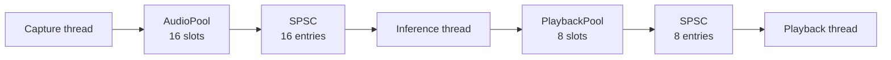
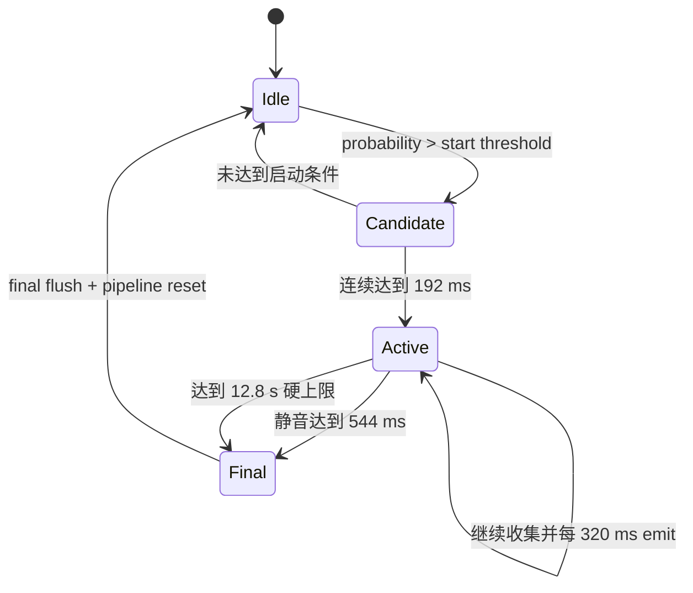
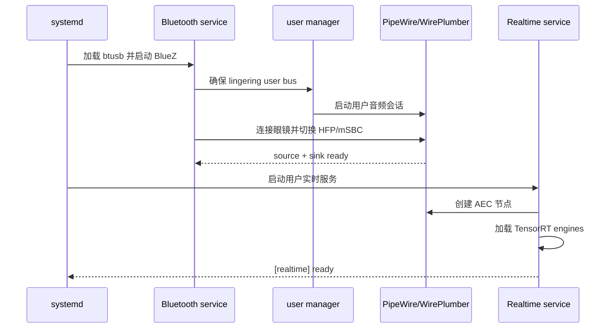

# StreamGlass 智能眼镜实时语音翻译系统技术 Proposal

> 文档类型：已部署版本技术方案与实施总结  
> 目标平台：NVIDIA Jetson AGX Orin Developer Kit  
> 项目目录：`/home/jetson/streamglass-deploy-staging`  
> 运行资产根目录：`/opt/streamglass`  
> 文档版本：1.0  
> 更新日期：2026-07-23

## 1. 项目摘要

StreamGlass 是一套运行在 Jetson AGX Orin 上的本地实时语音到语音翻译系统。系统使用同一副蓝牙眼镜完成语音采集与译文播放，在设备端完成语音前端、流式翻译决策、文本到离散语音单元转换和波形生成，不依赖浏览器或云端推理。

本项目基于官方 Seamless Streaming 模型及其 320 ms READ/WRITE 语义，完成了从 PyTorch checkpoint 到 ONNX、TensorRT engine、C++20 运行时和蓝牙全双工音频链路的部署。模型结构、词表和官方翻译决策逻辑保持不变，部署侧只进行图导出、精度选择、显存复用、调度和音频工程优化。

当前系统已经实现：

- 16 kHz 单声道蓝牙眼镜麦克风采集。
- 每 320 ms 一次的官方流式 READ/WRITE 决策。
- Encoder、Monotonic Decoder、T2U 和 Vocoder 的 TensorRT 推理。
- C++20 常驻运行时和持久化 TensorRT execution context。
- Decoder prefill/step 显式 KV cache engine。
- 增量 fbank、文本提交状态、T2U duration cursor 和增量 unit 输出。
- Silero VAD v6.2.1 TensorRT FP16 端侧切句。
- 蓝牙眼镜 HFP/mSBC 全双工输入输出。
- PipeWire WebRTC AEC 回声消除。
- 有序播放、交叉淡化、自适应 jitter buffer 和尾部淡出。
- 无头蓝牙连接、断线恢复和 systemd 上电启动。
- 默认不保存 PCM，运行日志保存在 RAM。
- 180 句实时回放与 180 句压力模式长进程验收。

## 2. 项目背景

### 2.1 原始需求

目标设备是一副具备麦克风、扬声器和触控能力的蓝牙眼镜，Jetson AGX Orin 作为随身或边缘计算主机。用户希望直接对眼镜说话，并从同一副眼镜听到翻译结果。

系统需要同时满足以下条件：

1. 翻译在本地完成，不依赖公网。
2. 输入和输出都来自蓝牙眼镜。
3. 不是录完整句子后一次性翻译，而是按模型官方策略持续 READ/WRITE。
4. 持续输入不能让推理队列无限积压。
5. 输出语音不能出现明显爆音、重音、抢占或片段间断裂。
6. 播放声音不能再次被麦克风采集并触发翻译。
7. 不能持续写入 eMMC 或依赖大量临时音频文件。
8. 设备无人登录桌面时仍能自动连接眼镜并启动服务。

### 2.2 主要工程难点

模型能离线运行不等于能够形成稳定的实时产品。部署过程中需要同时处理四类问题：

- **模型问题**：动态图、动态序列、Monotonic Decoder、T2U 动态展开和 Vocoder 动态 unit 长度。
- **实时问题**：320 ms 输入节拍、单步推理 deadline、跨步骤状态和队列背压。
- **音频问题**：蓝牙 profile、采样格式、播放时钟、回声、自激、爆音和 underrun。
- **系统问题**：无头登录、USB 蓝牙驱动、PipeWire 所有权、上电启动、断线恢复和 eMMC 寿命。

## 3. 建设目标与验收原则

### 3.1 功能目标

- 从蓝牙眼镜实时采集语音。
- 使用 Seamless Streaming 完成多语言语音到目标语言语音翻译。
- 通过同一副眼镜播放翻译结果。
- 维持官方 320 ms policy 调用粒度。
- 在句末完成最终 WRITE，并清理当前 utterance 状态。
- 支持长句硬边界，防止无界上下文增长。

### 3.2 性能目标

- 320 ms 输入周期内，单次关键推理不持续积压。
- 常规推理目标不高于 200 ms。
- 单步推理硬上限不高于 240 ms。
- 播放队列不形成长期正斜率。
- 长进程内 RSS 和 CUDA 可用内存不持续泄漏。

### 3.3 一致性目标

- 不修改模型结构。
- 不修改词表。
- 不使用剪枝、蒸馏或替换注意力。
- 保持官方 READ/WRITE 判定、临时后缀处理和 EOS 语义。
- 对离散 token、unit、输出长度和最终文本进行逐级 parity 验证。

## 4. 总体架构

```mermaid
flowchart LR
    G["蓝牙眼镜<br/>HFP/mSBC 麦克风与扬声器"]
    B["BlueZ + BARROT USB 蓝牙适配器"]
    P["PipeWire / WirePlumber"]
    A["WebRTC AEC<br/>16 kHz mono"]
    V["Silero VAD TensorRT<br/>32 ms 决策窗口"]
    F["官方增量 Fbank<br/>320 ms 模型分段"]
    E["Encoder TensorRT"]
    M["Monotonic Decoder<br/>官方 READ/WRITE"]
    T["T2U TensorRT<br/>duration cursor"]
    H["Vocoder TensorRT"]
    Q["有序播放队列<br/>jitter + crossfade"]

    G --> B --> P --> A --> V --> F --> E --> M --> T --> H --> Q --> A --> P --> B --> G
```



系统划分为四个平面：

| 平面 | 责任 |
|---|---|
| 设备平面 | USB 蓝牙适配器、蓝牙眼镜、HFP/mSBC profile |
| 音频平面 | PipeWire 采集/播放、AEC、格式固定和播放时钟 |
| 推理平面 | VAD、fbank、Encoder、Decoder、T2U、Vocoder |
| 运维平面 | systemd、无头用户会话、日志、模型校验和故障恢复 |

## 5. 目标硬件与软件环境

### 5.1 目标设备

| 项目 | 当前部署 |
|---|---|
| 计算平台 | NVIDIA Jetson AGX Orin Developer Kit |
| CPU 架构 | AArch64 |
| 内存 | 64 GB 统一内存 |
| 电源模式 | MAXN |
| 系统盘 | 约 64 GB eMMC |
| 数据盘 | Samsung 970 EVO Plus 1 TB NVMe |
| 蓝牙适配器 | BARROT USB Bluetooth，USB ID `33fa:0012` |
| 蓝牙眼镜 | `ZH-ZCGF` |

### 5.2 软件指纹

| 组件 | 版本 |
|---|---|
| Ubuntu | 24.04.4 LTS |
| Linux kernel | `6.8.12-1021-tegra` |
| L4T | R39.2.0 |
| CUDA | 13.2 |
| TensorRT | 10.16.2 |
| BlueZ | 5.72 |
| PipeWire | 1.0.5 |
| WirePlumber | 0.4.17 |
| C++ | C++20 |

平台信息由 `deploy/audit_platform.py` 采集并写入 `config/platform.lock.json`。其指纹参与 engine cache 目录选择，避免把不兼容平台生成的 TensorRT engine 直接复用到当前设备。

### 5.3 存储布局

系统根分区保留在 eMMC，模型、engine、容器数据和构建结果放在 NVMe：

```text
eMMC
└── /                       系统与少量配置

NVMe
└── /mnt/streamglass-data
    └── streamglass
        ├── engine-cache
        ├── model-cache
        ├── tmp
        └── runtime assets

/opt/streamglass -> /mnt/streamglass-data/streamglass
```

这样既保留 Jetson 系统启动方式，又避免多 GB checkpoint、TensorRT tactic cache 和构建中间文件挤占或频繁写入 eMMC。

## 6. 模型部署方案

### 6.1 模型组成

部署使用官方 `facebook/seamless-streaming` 模型资产：

| 文件 | 作用 | 大小 |
|---|---|---:|
| `seamless_streaming_unity.pt` | 语音 Encoder 与 T2U | 约 3.59 GB |
| `seamless_streaming_monotonic_decoder.pt` | 单调文本 Decoder | 约 4.27 GB |
| `vocoder_v2.pt` | Unit Vocoder | 约 168 MB |
| `tokenizer.model` | 文本 tokenizer | 约 5.17 MB |
| `spm_char_lang38_tc.model` | Unit/T2U tokenizer | 约 369 KB |

每个文件的字节数和 SHA-256 均记录在 `config/models.manifest.json`，部署和同步后可以检测缺失、截断或内容损坏。

### 6.2 转换流水线

模型转换采用以下流程：

```text
官方 PyTorch checkpoint
  -> 真实官方调用抓取
  -> 子图 wrapper
  -> ONNX opset 17
  -> ONNX 结构与输出验证
  -> AGX TensorRT build
  -> 模块 parity
  -> 原生 C++ 全链路 replay
  -> 长进程验收
```

导出过程不是根据网络结构手写一套近似模型，而是加载官方 checkpoint 并复用官方子模块。每个阶段先抓取真实输入输出，再用相同样例检查 ONNX 和 TensorRT 结果。

### 6.3 TensorRT engine 拆分

| Engine | 主要输入输出 | 具体作用 | 部署精度 |
|---|---|---|---|
| `encoder_cumulative_fp16.engine` | fbank -> encoder hidden states | 将累计输入语音的 Mel filter-bank 特征编码成带上下文的声学 hidden states，供 Monotonic Decoder 理解源语音内容。它是翻译模型的声学前端，不直接生成文本或声音。 | FP16 |
| `decoder_prefill_mixed.engine` | text prefix + encoder states -> token/decision/cache | 在一次解码开始或需要装载已有文本前缀时，处理完整 target prefix，生成首个候选 token、Monotonic READ/WRITE 决策值，并初始化 self-attention K/V cache。 | mixed precision |
| `decoder_step_mixed.engine` | one token + KV cache -> next token/decision/cache | 在 prefill 之后逐 token 增量生成译文。它复用已有 K/V cache，只处理最新 token，同时更新 cache 和 READ/WRITE 决策，避免在同一轮生成中反复计算完整文本前缀。 | mixed precision |
| `t2u_frontend_fp16.engine` | text features + characters -> duration/features | 把已确认输出的目标文本 token 转成字符级语音特征，并预测每个字符应持续多少个 unit 时间步。它决定“说什么”对应的初始发音表示和时长。 | FP16 |
| `t2u_decoder_fp32.engine` | expanded character features -> unit ids | 接收按照 duration 展开的字符特征，预测离散 acoustic unit ids。Unit 是目标语音的中间声学表示，也是 Vocoder 的直接输入。 | FP32 |
| `vocoder_fp16.engine` | unit ids + language/speaker -> waveform | 根据 unit ids、目标语言 ID 和 speaker conditioning 合成 16 kHz waveform，完成从离散声学单元到最终可播放 PCM 的转换。 | FP16 |
| `silero_vad_16k_fp16.engine` | 512 samples + recurrent state -> speech probability | 在翻译模型之前判断当前 32 ms 窗口是否包含语音。其概率驱动启动确认、连续收音和句末静音状态机，不参与翻译内容生成。 | FP16 |

各 engine 在运行时的关系如下：

```text
16 kHz microphone PCM
  -> Silero VAD
  -> utterance segmenter
  -> fbank frontend
  -> Encoder
  -> Decoder Prefill
  -> Decoder Step (按需循环)
  -> target text tokens
  -> T2U Frontend
  -> C++/CUDA duration expand
  -> T2U Decoder
  -> acoustic unit ids
  -> Vocoder
  -> 16 kHz translated PCM
```

其中 `decoder_prefill_mixed.engine` 和 `decoder_step_mixed.engine` 共同构成文本翻译 Decoder：prefill 负责建立上下文和 cache，step 负责后续增量生成。`t2u_frontend_fp16.engine` 与 `t2u_decoder_fp32.engine` 之间的数据相关 duration 展开由 C++/CUDA 运行时完成，它不是一个独立 TensorRT engine。

精度不是全链路统一降低。对数值敏感、会改变离散 argmax 的 T2U 输出头保留 FP32；Encoder、Vocoder 和稳定的线性计算使用 FP16；Decoder 使用经过 parity 验证的 mixed precision。

### 6.4 动态 shape

动态序列范围在 engine build 时显式定义：

- Encoder fbank 最大 2,000 帧。
- Encoder 输出最大 256 帧。
- Decoder target prefix 最大 512 token。
- T2U text/character/unit 采用各自动态 profile。
- Vocoder unit 长度覆盖 1、8、64 和 256 等实际与边界形状。

构建脚本先输出到 `.building.<pid>` 临时文件，完成并校验非空后再原子替换正式 engine，避免中断构建留下损坏的生产文件。

### 6.5 部署攻坚过程总览

这次部署不是把一个 `.pt` 文件直接交给 TensorRT。官方实现由多个 checkpoint、fairseq2/Seamless Communication 代码、动态状态和 Python policy 共同组成，TensorRT 只接受显式计算图和明确的输入输出契约。因此，实际工作分成了五层：

1. 先在官方 PyTorch 环境中复现模型行为。
2. 在不改变官方子模块计算的前提下，捕获真实调用边界。
3. 把不同状态和动态行为拆成 TensorRT 可以表达的子图。
4. 在 AGX 上构建 engine，并逐层对齐离散输出。
5. 最后才用 C++ 重建官方 policy、状态生命周期和音频调度。

以下各节记录部署中真正阻塞过项目的问题，以及最终采用的解决方案。

### 6.6 难题一：AGX 无公网，Mac 又不能直接通过 USB SSH

#### 现象

AGX 没有接入公网，USB device-mode 地址为 `192.168.55.1`。Jetson 端的 `l4tbr0` 和 SSH 服务正常，但当时 Mac 侧没有稳定得到可用的 `192.168.55.0/24` USB 虚拟网卡；Windows 主机却能获得 `192.168.55.100` 并直接访问 AGX。

这会阻塞：

- 代码和模型同步。
- 远程构建 TensorRT engine。
- 查看长时间构建日志。
- 服务调试和重启。

#### 根因

问题不在 AGX 的 SSH 服务，而在主机侧 USB gadget/RNDIS 枚举差异。AGX 已经监听 `0.0.0.0:22`，`l4tbr0` 也具有 `192.168.55.1/24`，说明 Jetson 端网络配置成立。

#### 处理

将 Windows 作为稳定跳板：

```text
Mac
  -> Windows TCP relay 192.168.82.80:2222
  -> AGX USB network 192.168.55.1:22
```

Mac 端使用：

```bash
ssh -i ~/.ssh/id_ed25519 -p 2222 jetson@192.168.82.80
```

跳板只负责部署控制，不进入实时音频或推理数据路径。AGX 上的项目、服务和 engine 不依赖该地址，因此跳板关闭只影响远程维护，不影响本机离线翻译。

#### 验证

- 能从 Mac 持续执行 AGX 命令。
- 能同步项目和大文件。
- 能等待长时间 TensorRT build。
- AGX 端仍保持原生 `192.168.55.1:22` 服务。

### 6.7 难题二：系统在 eMMC，但模型和构建资产远大于系统盘预算

#### 现象

两个主 checkpoint 合计接近 8 GB。再叠加：

- 官方容器镜像。
- ONNX external data。
- 多套 precision probe engine。
- TensorRT timing cache。
- 构建日志和 parity fixture。

如果全部写入 eMMC，不仅空间不足，还会在反复构建和调试时产生大量写放大。

#### 根因

eMMC 适合系统启动和少量配置，不适合本项目的大模型工件生命周期。TensorRT build 会产生临时 engine、tactic/timing cache 和 CUDA cache；ONNX 大模型还可能使用外部权重文件。

#### 处理

保留 eMMC 作为系统根分区，把大资产迁移到 1 TB NVMe：

- `/opt/streamglass` 指向 NVMe 数据根。
- 模型、ONNX、engine、timing cache、容器数据和构建临时目录全部在 NVMe。
- 正式实时日志写入 `/dev/shm`。
- PCM 默认不落盘。
- 调试录音必须显式打开，并指定 NVMe 路径。

构建脚本还把 `CUDA_CACHE_PATH`、`XDG_CACHE_HOME` 和 `TMPDIR` 指向 NVMe，避免工具链暗中回写用户 home 或 `/tmp` 所在的 eMMC。

#### 验证

- 系统仍由 eMMC 正常启动。
- 生产路径不持续写 PCM。
- 大型构建不占满根分区。
- engine cache 可以删除重建，不与系统文件耦合。

### 6.8 难题三：官方环境与 Jetson 平台版本必须严格匹配

#### 现象

TensorRT engine 是平台相关的序列化产物。此前在其他 Jetson 上曾出现：

```text
Serialization assertion actualTypehash == expectedTypehash failed
Engine deserialization failed
```

这类错误说明 engine 与当前 TensorRT、CUDA、GPU 架构或插件版本不兼容。把其他机器生成的 engine 直接拷到 AGX，不能视为可靠部署。

#### 根因

TensorRT engine 不是 ONNX 那样的平台无关格式。其 tactic、kernel 和序列化结构与构建平台绑定。JetPack/L4T、TensorRT 或 CUDA 变化后，旧 engine 可能直接无法反序列化，也可能在 plugin 层出现兼容风险。

#### 处理

1. 用 `deploy/audit_platform.py` 冻结 AGX 平台信息。
2. 根据 CUDA、TensorRT、L4T、内核和设备信息生成 fingerprint。
3. engine 路径包含该 fingerprint：

   ```text
   /opt/streamglass/engine-cache/<platform-fingerprint>/
   ```

4. ONNX 可以离线准备，但生产 engine 在 AGX 上用本机 TensorRT 构建。
5. 每个 engine 都生成 SHA-256。
6. 服务只读取当前 fingerprint 对应的生产 engine。
7. precision 实验使用不同文件名，不能覆盖 production engine。

官方 PyTorch reference 放在隔离容器中，容器层和 Docker/containerd 数据也迁移到 NVMe。网络不稳定时使用可恢复的镜像拉取和临时代理；reference 一旦准备完成，后续 parity 和生产运行不依赖公网。

#### 验证

- 当前 engine 能在 TensorRT 10.16.2 上反序列化。
- engine cache 与平台 fingerprint 一一对应。
- 实验 engine 不会污染生产默认路径。
- 模型原始文件由 manifest SHA-256 保护。

### 6.9 难题四：不能把官方 `.pt` 整图直接导出

#### 现象

官方 `.pt` 不是单一静态 `forward(input) -> output` 网络。完整推理过程同时包含：

- Speech Encoder。
- Monotonic text Decoder。
- Python READ/WRITE policy。
- Decoder cache state。
- T2U duration 与数据相关 repeat/expand。
- Unit Decoder。
- Vocoder language/speaker conditioning。
- Tokenizer 和文本后处理。

整图导出会遇到 Python 控制流、动态循环、动态 Slice、状态容器和数据相关输出长度，TensorRT 无法按一个静态图直接接管。

#### 根因

`.pt` 同时保存权重和模型配置，但“完整应用行为”还分布在官方 Python 代码及 agent state 中。只抽权重、不复现 policy，会得到一个能计算张量但行为不等价的近似系统。

#### 处理

采用“真实调用捕获 + 子图导出 + C++ policy 重建”：

1. 运行官方 Seamless Streaming reference。
2. 在不改变结果的位置捕获每一次真实模块调用。
3. 保存输入 shape、有效长度、cache、token、`p_choose`、duration、unit 和 waveform。
4. 每个 wrapper 直接复用官方子模块。
5. 导出前先验证 wrapper 与官方捕获一致。
6. 导出 ONNX 后再次验证。
7. 构建 TensorRT 后做第三次 parity。
8. 最后用 C++ 按官方顺序串接。

因此，系统不是“根据论文猜一个等价网络”，而是以官方执行 trace 为契约逐模块替换。

#### 验证

- Wrapper 导出前必须通过真实 capture。
- ONNX 输入输出名和动态轴有 manifest。
- TensorRT parity 覆盖真实长度，而不只测随机张量。
- 全链路最终检查 READ/WRITE、token、unit、输出长度和文本。

### 6.10 难题五：Encoder 的 Shaw 相对位置被 ONNX trace 固化

#### 现象

Encoder 从某个真实长度 trace 后，Shaw relative-position attention 中出现按 trace 长度固化的 `Slice`。直接构建会导致：

- 只在 trace 长度附近可用。
- 更长或更短输入 shape 失败。
- TensorRT parser 在 Slice/类型分支上报错。
- 虽然 ONNX 标注了动态轴，内部注意力仍然是固定长度。

#### 根因

PyTorch trace 把构图时的相对位置索引和尾部 Slice 具体化了。官方图中的若干常量还以 `INT64` 或 `DOUBLE -inf` 进入 FP16 路径，TensorRT 对这些类型组合更严格。

#### 处理

`normalize_encoder_onnx_for_trt.py` 对导出图做受计数保护的数学等价归一化：

1. 识别 24 层 Shaw attention 的固定 Slice 模式。
2. 从 query tensor 的运行时 shape 读取序列长度。
3. 用 `Range -> Unsqueeze -> Transpose -> Sub` 重建动态相对位置索引。
4. 绕过被 trace 长度固定的 Slice。
5. 把 padding 分支的 `INT64 0` 转为计算 dtype。
6. 把 attention 分支的 `DOUBLE -inf` 转为兼容 dtype。
7. 要求命中的层数和 cast 数量严格等于预期；少一个或多一个都拒绝生成生产图。

归一化不是任意改图。脚本同时保存 manifest 和 SHA-256，并用官方捕获检查有效帧输出和 sequence length。

#### 验证

- Engine profile 覆盖 `222/600/2000` fbank 帧。
- 每层动态恢复数量为 24。
- 真实 capture 的有效 Encoder 输出通过 parity。
- 构建使用完整 tactic search：optimization level 5 和 16 GB workspace。

### 6.11 难题六：Monotonic Decoder 同时包含动态前缀、决策值和 KV 状态

#### 现象

如果每生成一个 token 都把完整文本前缀送入同一个 Decoder 图：

- 计算量随 token 数增加。
- 每次都重新生成 causal mask。
- self-attention K/V 重复计算。
- 动态循环难以稳定导出。
- `p_choose` 的微小误差可能改变 READ/WRITE 时机。

#### 根因

Monotonic Decoder 既是自回归文本生成器，又输出流式决策概率。普通“只看 argmax token”的 parity 不够；即使 token 暂时相同，`p_choose` 误差也可能让下一次 policy 提前 WRITE 或继续 READ。

#### 处理

拆成两个显式 engine：

- `decoder_prefill_mixed.engine`：输入完整 prefix、Encoder states 和 causal mask，输出最后 token 的 logits、`p_choose` 以及完整 K/V。
- `decoder_step_mixed.engine`：输入单 token、position、Encoder states 和旧 K/V，输出新结果和新 K/V。

C++ 端进一步完成：

- causal mask 在 GPU 上生成。
- argmax 和 decision reduction 在 GPU 上完成。
- 两套 K/V buffer ping-pong。
- position、selected index 和 probability 使用 mapped host control buffer。
- policy 内生成多个 token 时只调用 step，不重复 prefill。

Parity 不只比较最终文本，还逐 call 比较：

- selected token。
- decision probability。
- Decoder hidden cosine。
- K/V cosine。
- cache length。

#### 验证

- Prefill 与 step 都覆盖真实 capture。
- 动态 prefix 最高覆盖 512 token。
- selected token 必须完全相同。
- hidden/K/V cosine 门限不低于 0.999。
- decision probability 误差受限，最终 READ/WRITE 与官方一致。

### 6.12 难题七：T2U 的 duration 展开是数据相关动态行为

#### 现象

T2U 不是固定长度的 `text -> units` 映射。模型先预测每个字符的 duration，再根据 duration 执行 `repeat_interleave`，因此 unit 序列长度只有运行时才能确定。

直接把整段导入一个 TensorRT 图时，动态 repeat、Slice 和输出长度容易构建失败；即使构建成功，FP16 误差也可能在最终 argmax 放大成不同 unit。

#### 根因

T2U 包含两个性质不同的阶段：

1. 文本特征、字符特征和 duration 预测。
2. 根据 duration 展开后执行 unit decoder。

二者之间的序列长度是数据依赖边界，不适合强行隐藏在一个静态 engine 内。

#### 处理

拆成：

- `t2u_frontend_fp16.engine`：输出 character features 和 duration。
- C++/CUDA 运行时：计算 duration offset、确定 unit 总长并展开 features。
- `t2u_decoder_fp32.engine`：对动态长度 expanded features 生成 unit ids。

运行时还保存 `duration_cursor`，只取尚未播放的 duration 后缀。这样同时解决动态构图和重复播放问题。

T2U 精度采用分层策略：

- Frontend 使用 FP16。
- 对离散 unit 最敏感的 Decoder 使用 strongly typed FP32。
- precision probe 使用独立 engine 文件。
- 只有通过 unit parity 的组合才能进入 production 路径。

#### 验证

- Duration 必须与官方完全相同。
- Unit ids 逐位置比较。
- 动态 profile 覆盖 text、character 和 unit 实际长度。
- 当前全链路达到 136/137 unit 一致，最终 80-unit WRITE 完全一致。

### 6.13 难题八：Vocoder engine 能运行，但错误 unit 会产生“蜂鸣/乱码”

#### 现象

早期只把测试 JSON 或错误构造的 unit 输入 Vocoder 时，生成 WAV 可能只有蜂鸣、快速重复音节或不可理解的“略略略”。这并不是把 JSON 数值简单写成 WAV，也不是播放库的问题。

#### 根因

Vocoder 只负责：

```text
正确的离散 unit + language ID + speaker ID -> waveform
```

它不能修复错误 unit。缺少 MT/T2U 中间链路、unit 编码空间不匹配、duration 错误，都会让一个技术上有效的波形听起来完全错误。

#### 处理

1. 停止使用手工 JSON 到 PCM 的测试替代正式链路。
2. 用官方 T2U 输出作为 Vocoder parity 输入。
3. 固定 language/speaker conditioning 来源。
4. 覆盖 unit 长度 1、8、64 和 256 的动态 profile。
5. 检查 waveform shape、有限值、长度和参考误差。
6. 在全链路中保持 unit 在 GPU 上，直到进入 Vocoder。

#### 验证

- 输出不是直接序列化 JSON，而是官方 Vocoder 生成的 float waveform。
- 波形无 NaN/Inf。
- unit 长度和输出 sample count 符合官方参考。
- 全链路输入后可得到可理解语音，而非单纯蜂鸣。

### 6.14 难题九：精度优化不能只看张量平均误差

#### 现象

某些 FP16 engine 的 hidden tensor 误差很小，但最终 token、duration 或 unit 会发生离散跳变。反过来，提高整个图的精度也不一定消除一个处于数值 tie 附近的 unit 差异。

#### 根因

模型中存在多个离散边界：

- token argmax。
- `p_choose=0.5` READ/WRITE 阈值。
- duration 整数化。
- unit argmax。

连续张量的微小误差在这些边界处会变成离散结果差异。因此只报告 cosine 或 mean absolute error，不能证明应用行为一致。

#### 处理

建立分层验收门：

1. 连续张量检查 max abs 和 cosine。
2. 决策层检查 `p_choose` 与 READ/WRITE。
3. 文本层检查 token 序列。
4. T2U 检查 duration 和 unit。
5. 音频层检查 output samples、RMS、peak 和 checksum。
6. 长进程检查每句结果是否确定。

生产精度按模块选择，而不是统一 FP16：

- Encoder：FP16。
- Decoder：mixed。
- T2U frontend：FP16。
- T2U decoder：FP32。
- Vocoder：FP16。

唯一 1-unit 差异被明确记录为容差，没有用“整体误差很小”掩盖。

### 6.15 难题十：320 ms 输入节拍下不能允许隐性排队

#### 现象

如果每 320 ms 到达一个输入块，而某一步处理超过 320 ms，队列延迟会持续增加。短时间看只是响应稍慢，长句或长会话中会表现为越来越卡。

#### 根因

平均延迟不足以证明实时性。必须同时约束：

- 最慢 policy step。
- capture queue age。
- queue high-water。
- 最终 WRITE 峰值。
- 资源增长。

#### 处理

- TensorRT context 和 buffer 跨句复用。
- CUDA 后处理替代大张量回传 CPU。
- 预分配 mapped host/device buffer。
- 输入队列有界。
- 一个 320 ms segment 对应一次 policy，不为追吞吐而合并决策。
- 推理目标设为 200 ms，硬门设为 240 ms。
- 最终用 real-time 和 no-wait stress 两种模式检查。

#### 验证

- 实时最大单步 223.570 ms。
- 压力模式最大单步 214.228 ms。
- 实时 capture queue high-water 为 1。
- Playback queue high-water 为 1。
- 180 句实时与 180 句压力输出 checksum 一致。

## 7. 官方 320 ms 流式语义

### 7.1 输入节拍

模型输入固定为 16 kHz、单声道、浮点 PCM。每 320 ms 对应：

```text
16,000 samples/s × 0.320 s = 5,120 samples
```

采集端按 32 ms 窗口进行 VAD 判定，激活后的音频按 5,120 samples 组成模型 segment。句末不足 320 ms 的尾包通过 `source_finished=true` 原样送入最终 policy。

### 7.2 增量 Fbank

前端复用官方 Kaldi Native Fbank 实现，参数与官方模型保持一致：

- 输入采样率：16 kHz。
- 特征维度：80。
- 窗长：25 ms。
- 帧移：10 ms。
- 保存跨音频块残余采样。

增量前端只处理新增 PCM，不会在每个 320 ms 步骤重新计算已经完成的原始波形窗口。

### 7.3 READ/WRITE 决策

当累计 fbank 达到模型可执行长度后，系统运行 Encoder 和 Monotonic Decoder。Decoder 输出：

- 下一个 token。
- `p_choose` 决策概率。
- Decoder features。
- self-attention K/V。

文本 policy 保持官方阈值 `0.5` 和 `no_early_stop` 行为：

- 当前前缀不稳定时返回 `READ`，继续接收音频。
- 当前前缀稳定时返回 `WRITE`，提交新增 token。
- 非句末阶段出现临时 EOS 时，按官方规则丢弃未提交后缀。
- `source_finished=true` 时执行最终解码并完成当前 utterance。

### 7.4 Decoder prefill 与 step

Decoder 被拆成两个 engine：

- `prefill`：处理当前完整文本 prefix，并生成第一步结果和 KV cache。
- `step`：每次只处理一个新 token，并复用当前 policy 内的 KV cache。

运行时预分配两套工作 K/V buffer，以 ping-pong 方式在 step 间交换，避免每个 token 重新申请显存。

代码中还实现了跨 policy 的 canonical cache 探测模式。该模式默认关闭，生产默认仍走 reference 语义；启用时只允许低概率 READ 直接使用 cache，WRITE 和定期校验仍回到 fresh prefill，以避免陈旧 KV 改变已提交内容。

### 7.5 增量 T2U

文本 WRITE 后，T2U 根据已提交文本生成离散语音 unit。运行时保存：

- 已提交文本 token。
- 对应 Decoder features。
- `duration_cursor`。
- 文本版本号。
- 当前 T2U memo。

只有新的稳定文本进入时才更新保留特征；T2U 根据 `duration_cursor` 从尚未播放的位置继续生成，避免重复播放已经提交的 unit。文本版本变化时显式使 memo 失效，防止旧状态污染新前缀。

### 7.6 Vocoder

Vocoder 接收当前新增 unit、目标语言 ID 和 speaker ID，输出 16 kHz 波形。Unit 保持在 GPU 上直到 Vocoder 输入，最终波形直接写入预分配的 CUDA mapped host buffer，供播放阶段读取。

## 8. C++ 运行时实现

### 8.1 模块边界

核心 C++ 类如下：

| 类 | 责任 |
|---|---|
| `OfficialOnlineFbank` | 官方增量声学前端 |
| `EncoderRuntime` | Encoder TensorRT context 与持久 buffer |
| `DecoderRuntime` | prefill/step、KV cache 和 CUDA argmax |
| `StreamingTextPolicy` | 官方 READ/WRITE 与 token 提交 |
| `T2uRuntime` | 文本到 unit、duration cursor 与 suffix |
| `VocoderRuntime` | unit 到 waveform |
| `StreamingPipeline` | 串接并管理一个 utterance 的全部状态 |
| `UtteranceSegmenter` | VAD、pre-roll、320 ms 分段和句末 |
| `PlaybackQueue` | 有序播放、缓冲、crossfade 和 fade |

### 8.2 持久化执行资源

模型加载后，TensorRT engine、execution context、CUDA stream 和主要 GPU buffer 在进程生命周期内保持不变。每个 utterance 只重置语义状态，不销毁和重建 engine。

主要预分配对象包括：

- 最大 fbank 输入 buffer。
- Encoder 输出 buffer。
- Decoder causal mask、logits、decision 和双份 K/V buffer。
- T2U 字符、duration、expanded feature 和 unit buffer。
- Vocoder 最大 waveform buffer。
- CUDA mapped host control/output buffer。

这一设计降低了频繁 `cudaMalloc/cudaFree` 带来的延迟抖动和显存碎片。

### 8.3 应用层零拷贝验收路径

三线程验收运行时采用固定容量对象池和有界 SPSC ring：



队列中只传递 `BufferHandle`，不传大块 PCM 或 waveform。Handle 包含 slot index 和 generation，可检测释放后误用的 stale handle。Buffer 所有权在 producer、queue 和 consumer 间转移，消费完成后归还 pool。

这里的“零拷贝”限定为 PCM 进入应用对象池之后的跨线程传递。蓝牙内核、PipeWire 和应用入口之间仍存在系统边界复制，不宣称全链路硬件零拷贝。

### 8.4 当前实时进程结构

生产启动脚本使用：

```text
pw-record
  -> streamglass-native-realtime
  -> pw-play
```

其中模型、VAD、分段、推理、T2U、Vocoder 和播放整形都在一个常驻 C++ 进程中；`pw-record` 和 `pw-play` 是 PipeWire 的采集与播放辅助进程。C++ 进程内部另有独立 playback worker，避免设备播放时钟阻塞采集/推理主循环。

### 8.5 背压与顺序

- 输入和播放队列都有固定上限。
- 队列满时明确等待或拒绝，不静默覆盖旧数据。
- 每个 320 ms segment 保持独立 policy 调用，不把多个块合并成一次决策。
- 每个播放块携带 `utterance_id` 和 `write_id`。
- 乱序、重复或跨 utterance 的非法 WRITE 会被明确拒绝。
- 下一句输入不会取消上一句已提交的播放内容。

## 9. VAD 与切句

### 9.1 为什么最初使用 RMS

第一版切句器采用手写 RMS 能量判定。对每个音频窗口计算：

```text
RMS = sqrt((1 / N) * sum(x[n]^2))
```

再把 RMS 与启动阈值、连续阈值比较。这个方案的优点是实现简单、无模型依赖、计算量很小，适合在音频通路尚未稳定时验证采集、队列和切句状态机。

但 RMS 回答的只是“这一帧能量有多大”，并不能回答“这一帧是不是人声”。原始实现甚至把归一化后的 RMS 直接当作类似概率的控制值，因此下列信号在状态机中没有本质区别：

- 近场讲话。
- 扬声器泄漏回来的翻译语音。
- 轻咳、轻哼和敲击声。
- 风噪、底噪和蓝牙链路中的瞬态。
- 手机扬声器播放的人声。

### 9.2 手写 RMS 在真实使用中的失败模式

项目曾反复调整 RMS 的启动阈值、连续阈值、启动确认和结束静音，例如启动阈值约 `0.029-0.030`、连续阈值约 `0.015-0.016`、启动确认 `144-192 ms`、结束静音 `544-620 ms`。这些调整可以改善某一种样例，但无法同时满足慢语速连续性和环境抗干扰。

具体表现如下：

| 调整方向 | 得到的改善 | 同时引入的问题 |
|---|---|---|
| 提高启动阈值 | 减少底噪、轻哼和轻咳误触发 | 正常音量或慢语速首音更容易被截掉 |
| 降低启动阈值 | 更容易开始采集 | 键盘、呼吸、回声也会启动新句 |
| 提高连续阈值 | 静音结束更干净 | 轻音节、句中停顿和尾音容易丢失 |
| 降低连续阈值 | 慢语速不易中断 | 背景噪声会让 utterance 长时间不结束 |
| 增大结束静音 | 减少句中误切 | 句末响应延迟增加，回声有更多机会进入 |
| 缩短启动确认 | 首包延迟降低 | 瞬态噪声更容易被当作讲话 |

这也是“语速快时效果反而更好”的根因之一。快速连续讲话会持续提供较高能量，RMS 状态机容易保持 Active；正常或较慢语速包含更多轻音节和自然间隔，能量会跨过阈值，造成中途结束或尾句缺失。

RMS 的局限不是继续微调一个数值就能解决：

1. 没有频谱特征，不能区分语音结构和宽带噪声。
2. 没有时序模型，只能依赖外部计数器判断连续性。
3. 不知道音素边界，弱辅音和句尾自然衰减很容易被视为静音。
4. 与播放回声的频率和能量无关，回声只要超过阈值就会再次启动。
5. 蓝牙增益、说话距离和不同播放设备会改变绝对幅度，使同一阈值难以迁移。

### 9.3 为什么选择 Silero，而不是继续堆叠 RMS 规则

Silero VAD 是针对语音活动训练的时序模型。它综合当前窗口的频谱和时间结构，并通过 recurrent state 保留前文状态。与 RMS 相比，它输出的是更接近“当前是否包含语音”的概率，而不是单纯的幅度。

| 能力 | 手写 RMS | Silero VAD |
|---|---|---|
| 基本依据 | 单窗口总能量 | 学习到的语音时频特征 |
| 时序状态 | 外部计数器 | 模型 recurrent state |
| 轻音节保留 | 依赖降低阈值 | 能结合上下文判断 |
| 瞬态噪声抑制 | 只能提高阈值 | 可识别非语音结构 |
| 设备幅度变化适应性 | 较差 | 相对更稳 |
| 单窗口 AGX 开销 | 极低 | 约 0.12 ms，仍远低于实时预算 |

Silero 并不替代切句状态机。最终方案仍然使用启动确认、pre-roll、结束静音和 utterance 上限，但把状态机的观测值从 RMS 能量换成 Silero speech probability。这样，规则负责产品语义，模型负责判断输入是否像语音。

### 9.4 Silero TensorRT 部署与灰度过程

Silero 没有直接替换生产服务。迁移按以下顺序完成：

1. 固定官方 Silero VAD v6.2.1 JIT 模型及 SHA-256。
2. 导出只包含 16 kHz core 的 ONNX，显式暴露音频、context 和 recurrent state。
3. 在 AGX 上构建独立 TensorRT FP16 engine，不覆盖原 RMS 版本。
4. 使用同一组真实窗口逐帧比较官方 PyTorch 与 TensorRT probability。
5. 进行 100 轮延迟测试，确认 VAD 不会占用 320 ms policy 预算。
6. 临时灰度启用，保留 RMS 启动方式用于立即回退。
7. 针对慢语速和轻哼重新标定启动/连续双阈值。
8. 用户确认慢语速问题消失且误触发可控后，才提升为开机生产默认。

模型和 engine 都有固定校验：

```text
Silero JIT SHA-256:
e1122837f4154c511485fe0b9c64455f7b929c96fbb8d79fbdb336383ebd3720

Silero TensorRT engine SHA-256:
6d686816ee7945e944a24db2accf4f40203f90d1986796b6dd775bf197ed6f21
```

生产 engine 位于平台指纹目录：

```text
/opt/streamglass/engine-cache/
  87d587047967766c63f3de7012a479fbd4f3c471ffea70efe8454017bf908709/
  silero_vad_16k_fp16.engine
```

运行时启动时校验输入输出 shape 和 recurrent state 大小。每个 utterance 结束后显式清空 state 与 64-sample context，防止上一句话影响下一句话。若未配置或无法加载 Silero engine，RMS 路径仍作为显式回退，而不是静默混用两套判定。

### 9.5 Silero TensorRT VAD

生产使用官方 Silero VAD v6.2.1 core：

- 输入：`[1, 576]`，由 64 个 context sample 和 512 个当前 sample 组成。
- recurrent state：`[2, 1, 128]`。
- 输出：`[1, 1]` speech probability。
- 输入采样率：16 kHz。
- engine：TensorRT FP16。

当前参数：

| 参数 | 值 |
|---|---:|
| 启动阈值 | 0.65 |
| 连续语音阈值 | 0.35 |
| 启动确认 | 192 ms |
| pre-roll | 192 ms |
| 结束静音 | 544 ms |
| utterance 硬上限 | 12.8 s |

双阈值解决两个相反问题：

- 较高启动阈值抑制轻哼、轻咳和环境噪声误触发。
- 较低连续阈值保留慢语速、轻音节和自然停顿，不在句中提前结束。

### 9.6 双阈值与分段状态机

状态机按 32 ms 窗口运行：



启动前保留 192 ms pre-roll，避免高阈值和启动确认截掉首音。句末会发送不足 320 ms 的剩余样本，避免尾句静音到来时直接丢失最后一段。

对于短于当前 Encoder 最小 profile 的有效 utterance，运行时只在内存中补齐必要静音，使最终语句仍能进入模型；不会生成临时 WAV 文件。

`0.65/0.35` 不是普通的高低能量阈值，而是 speech probability 的迟滞区间：

- Idle 状态只有连续窗口高于 `0.65` 才进入 Active。
- Active 后只要概率未持续低于 `0.35`，就继续保留该 utterance。
- 位于两者之间的模糊窗口不会反复切换状态。

启动前的 192 ms pre-roll 由有界内存环形缓冲保存。当 Candidate 满足启动确认时，pre-roll 与候选窗口一次性拼入当前 utterance，避免提高启动阈值后丢失句首。它不会写临时 WAV。

### 9.7 Silero parity

Silero TensorRT 与官方参考的已验收结果：

| 指标 | 结果 |
|---|---:|
| 测试窗口 | 124 |
| 重复次数 | 100 |
| 最大绝对误差 | 0.000228 |
| 平均绝对误差 | 0.000058 |
| 分类不一致 | 0 |
| P50 | 约 0.118 ms |
| P95 | 约 0.124 ms |
| P99 | 约 0.139 ms |

## 10. 蓝牙双向音频

### 10.1 Profile 与采样格式

同一副 `ZH-ZCGF` 眼镜同时作为输入和输出。系统固定使用 HFP/mSBC profile，对 PipeWire 暴露：

- `bluez_input.41_42_84_69_36_F8.0`
- `bluez_output.41_42_84_69_36_F8.1`

采集和播放统一为 16 kHz、mono、float32，避免在模型热路径中重复重采样。

### 10.2 BARROT USB 驱动问题

目标 JetPack 镜像中的第三方 `rtk_btusb` 安装规则会影响内核原生 `btusb` 的正常加载。BARROT `33fa:0012` 需要内核 `btusb`，而另一块 Realtek 控制器仍由 `rtk_btusb` 管理。

连接脚本通过：

```bash
modprobe --ignore-install btusb
```

显式加载原生驱动，并按控制器 MAC 选择 BARROT，而不是依赖系统默认控制器顺序。

### 10.3 无头会话

未登录桌面时，GDM 的 WirePlumber 可能占有 Bluetooth audio profile，而 lingering 用户会话因 logind seat policy 看不到设备。

项目采取以下措施：

1. 为 `jetson` 用户启用 `loginctl enable-linger`。
2. 启动用户 D-Bus、PipeWire、PipeWire Pulse 和 WirePlumber。
3. 停止 GDM 用户占用的 WirePlumber 实例。
4. 安装 `51-streamglass-bluez.lua`，允许无头用户拥有 Bluetooth audio。
5. 使用 BlueZ `NoInputNoOutput` agent，避免桌面配对弹窗。
6. 信任并连接指定眼镜。
7. 切换到 HFP/mSBC profile。
8. 只有 source 与 sink 同时出现后才认为设备就绪。

### 10.4 断线恢复

`streamglass-bluetooth.service` 持续监控：

- USB controller 是否存在。
- BlueZ 是否运行。
- PipeWire source 是否存在。
- PipeWire sink 是否存在。

任一端点丢失后，服务会重新加载会话、重启用户 WirePlumber 并循环连接，直到输入和输出都恢复。模型服务本身通过 `ExecStartPre` 等待音频端点，避免在设备未就绪时反复崩溃加载。

## 11. 回声消除

### 11.1 问题表现

当同一副眼镜同时收音和播放时，翻译语音会通过声学路径重新进入麦克风。未经处理时会出现：

- 译文再次触发 VAD。
- 模型把自己的英文输出作为新输入。
- 持续循环同一句，例如反复播放 “the first one”。
- 用户停止说话后系统仍不断生成语音。

这个问题在测试音播放、采集和模型推理分别正常后才暴露，因为它不是单模块错误，而是全双工闭环形成后的系统级自激：

```text
模型译文
  -> 眼镜扬声器
  -> 空气与眼镜结构传声
  -> 同一副眼镜麦克风
  -> VAD 再次启动
  -> 模型把译文当成新的源语言
  -> 再次播放
```

### 11.2 如何判断是声学回声，而不是播放队列重复

“同一句不断播放”也可能由队列重复提交、`write_id` 重复或播放线程未消费完成造成，因此不能直接归因于回声。排查时同时观察 capture、VAD、utterance 和 playback 四类事件：

1. 每次重复前都出现新的 capture 能量和新的 VAD speech start。
2. 重复内容属于新的 `utterance_id`，而不是旧 `write_id` 被再次消费。
3. 播放队列没有重复块，提交和消费 checksum 一致。
4. 眼镜音量降低或物理隔离麦克风后，重复显著减弱。
5. 播放已知信号时，raw capture 中能找到延迟后的高相关副本。
6. 停止扬声器输出后，不再产生后续“幽灵 utterance”。

这些证据说明模型和播放线程只是按收到的新输入正常工作，真正的问题是输出声学泄漏重新进入输入。日志中的 “the first one” 是回声触发后的模型结果，不是程序写死的默认播放内容。

### 11.3 为什么阈值、文本过滤和半双工都不是最终解法

部署过程中评估过几种容易实现但不满足目标的处理方式：

| 方案 | 短期效果 | 没有采用为生产主方案的原因 |
|---|---|---|
| 提高 VAD 阈值 | 可减少较弱回声触发 | 同时漏掉正常音量、慢语速和尾音 |
| 播放时暂停采集 | 能完全阻断自激 | 破坏同一副眼镜要求的全双工交互，用户无法打断或继续讲话 |
| 过滤 “the first one” | 屏蔽一个已知结果 | 回声内容并不固定，会误杀用户真实输入 |
| 译文文本去重 | 减少重复播放 | 回声经过模型后可能变成不同文本，且问题已进入推理链路 |
| 固定静音窗口 | 暂时延迟再次触发 | 增加交互延迟，仍可能在窗口结束后触发 |

Silero VAD 也不是回声消除器。它能比 RMS 更好地区分语音和环境噪声，但扬声器回放本身就是清晰语音，VAD 理应把它判断为 speech。因此，必须在 VAD 之前消除已知播放参考。

### 11.4 生产 AEC 拓扑

运行时创建 session-scoped PipeWire WebRTC AEC graph：

```text
眼镜麦克风
  -> raw Bluetooth source
  -> WebRTC AEC capture
  -> streamglass_aec_source
  -> C++ runtime

C++ translated PCM
  -> streamglass_aec_sink
  -> AEC playback reference
  -> raw Bluetooth sink
  -> 眼镜扬声器
```

这里的 “WebRTC AEC” 指 PipeWire echo-cancel 模块使用的 WebRTC Audio Processing 算法，不是浏览器 WebRTC，也不是网络传输协议。AEC 的两个关键输入是：

- 麦克风采集到的混合信号。
- 程序即将送往眼镜扬声器的原始 translated PCM，作为 playback reference。

只有经过 AEC 的 `streamglass_aec_source` 可以进入 VAD 和模型。翻译播放必须经过 `streamglass_aec_sink`，否则 AEC 看不到参考信号，无法从麦克风输入中估计并抵消回声。

AEC 参数包括：

- WebRTC delay agnostic。
- Extended filter。
- High-pass filter。
- Noise suppression。
- 固定 16 kHz mono。
- 禁用 AEC 内部 AGC，避免与模型输入幅度策略叠加。

AEC node 只在当前翻译 session 生命周期内存在。启动流程先确认 raw Bluetooth source/sink，再创建 AEC source/sink，最后启动 C++ runtime。退出时按相反顺序释放，避免下次启动复用失效节点。

### 11.5 为什么参考延迟必须标定

当前眼镜的物理回放参考延迟标定为 180 ms，记录于：

`config/pipewire/streamglass-echo-cancel.args`

回放 reference 在软件中产生的时间早于它真正从眼镜扬声器传出并返回麦克风的时间。延迟来自：

- PipeWire 播放缓冲。
- HFP/mSBC 编码和蓝牙调度。
- 眼镜内部 DSP 与功放。
- 空气和结构传声。
- 麦克风采集与回传缓冲。

如果 reference 与 capture 没有时间对齐，AEC 会拿错误位置的波形做抵消，可能只降低部分能量，甚至留下足以触发 VAD 的残差。当前设备通过播放已知信号、计算 raw capture 与 reference 的相关峰，得到约 180 ms 的物理回放参考延迟。

该值与眼镜、蓝牙适配器和 profile 绑定。更换设备或 profile 后应重新标定，而不是沿用同一个常量。

### 11.6 AEC、VAD 与播放调度的顺序

生产数据流固定为：

```text
raw Bluetooth capture
  -> AEC
  -> Silero VAD
  -> 320 ms segmenter
  -> TensorRT translation
  -> ordered playback queue
  -> AEC reference sink
  -> raw Bluetooth playback
```

这个顺序解决三个容易混淆的问题：

1. **AEC 必须先于 VAD**：否则回声已经启动新 utterance，后面再抑制没有意义。
2. **VAD 双阈值不能承担 AEC 职责**：清晰回放语音本来就会得到较高 speech probability。
3. **播放队列必须向 AEC 提供完整参考**：crossfade、增益和最终送设备的时序都要与 reference 路径一致。

运行时仍保留 `HALF_DUPLEX=true` 作为故障诊断和设备不支持 AEC 时的回退，但生产配置为全双工，不在播放期间关闭采集。

### 11.7 回声闭环验收

最终使用约 15 秒的长句回归同时观察输入、翻译、播放和播放后的静音期。验收结果为：

- 正常产生 2 个有效 utterance，分别覆盖主句和尾段。
- 总播放音频约 11.092 秒。
- 播放后没有第三个由回声触发的 utterance。
- 没有再次循环 “the first one”。
- 最大实时积压为 64 ms，没有因 AEC 增加不可接受的队列延迟。

这个验收比“听起来没有回声”更严格：它要求播放结束后 capture/VAD 状态不重新进入 Active，同时不牺牲用户讲话的全双工采集能力。

## 12. 平滑播放

### 12.1 有序播放

播放块严格按 `(utterance_id, write_id)` 接收。以下情况不会被静默接受：

- write_id 跳号。
- 旧 utterance 晚到。
- 队列超过容量。

这种约束防止异步推理或异常恢复导致片段错序和重音。

### 12.2 自适应 jitter buffer

播放初始目标为 120 ms，范围 80 至 250 ms，使用 AIMD 策略：

- 出现 mid-utterance gap：增加 40 ms。
- 连续稳定 300 秒：降低 10 ms。
- 最终始终限制在上下界内。

这样既避免固定使用过大的缓冲增加延迟，也避免网络/推理轻微抖动立刻形成可听断裂。

### 12.3 Chunk 拼接

相邻 WRITE 采用：

- 8 ms equal-power crossfade。
- gap 后 5 ms fade-in。
- utterance 最终尾部 5 ms fade-out。

上一块末尾的 128 sample 暂缓提交，等下一块到达后进行交叉淡化。播放 consumer 只按设备时钟持续取样，不在每个 WRITE 重新打开音频设备。

### 12.4 不抢占策略

下一段输入和下一次推理可以继续进行，但不会直接取消已经进入播放队列的上一段内容。每个 utterance 的 WRITE 顺序由队列维护，解决了“上一句没播完，下一句直接抢跑”的问题。

## 13. 内存、磁盘与隐私

### 13.1 内存策略

- TensorRT context 常驻。
- CUDA stream 常驻。
- 大型 device buffer 按最大 profile 预分配。
- 控制量和最终 waveform 使用 CUDA mapped host memory。
- Threaded 验收路径使用固定 slot pool。
- 容器容量和队列高水位可观测。

### 13.2 磁盘策略

默认实时路径不写 PCM：

```text
Bluetooth capture -> RAM -> GPU -> RAM -> Bluetooth playback
```

只有显式设置 `STREAMGLASS_PLAYBACK_TAP` 时才允许调试录音，并要求使用 NVMe 路径。实时日志位于：

```text
/dev/shm/streamglass-realtime.log
```

该日志在内存文件系统中，重启后清空，不会持续磨损 eMMC。

### 13.3 本地隐私

语音、模型推理和播放均在 AGX 本地完成。系统不要求把语音上传到云端，也不在默认路径持久化音频或明文翻译。

## 14. systemd 服务化与高可用

系统使用两层服务：

| 服务 | 级别 | 责任 |
|---|---|---|
| `streamglass-bluetooth.service` | system | 驱动、控制器、配对、HFP、端点监控与恢复 |
| `streamglass-realtime.service` | user | AEC、采集、C++ 推理和播放 |

关键 systemd 策略：

- `Restart=always`。
- `RestartSec=3`。
- `StartLimitIntervalSec=0`。
- `TimeoutStartSec=infinity`，允许等待眼镜上线。
- `KillMode=control-group`，停止时清理整个音频 pipeline。
- 用户 linger 保证未登录桌面也能运行 PipeWire。
- 实时服务启动前等待 source 和 sink 同时就绪。

上电流程：



## 15. 实施中解决的核心问题

| 问题 | 根因 | 已实施解决方案 | 结果 |
|---|---|---|---|
| TensorRT 无法直接覆盖整图 | 动态序列、Decoder cache、T2U 展开 | 按官方模块拆分 engine，显式定义动态 I/O | 全链路 C++ TensorRT 可运行 |
| 动态 Slice/shape 构建困难 | TensorRT 对动态图表达有限 | ONNX 归一化、子图拆分和 host-side 数据依赖控制 | 真实 profile 构建成功 |
| 精度下降导致 unit 改变 | FP16 对离散输出头敏感 | T2U frontend FP16、decoder FP32，逐模块 parity | 136/137 unit 一致 |
| 每个 token 重跑 Decoder | 自回归生成 | prefill + step engine，policy 内显式 KV cache | 减少 Decoder 重复计算 |
| T2U 重复输出前缀 | 每次文本前缀增长 | 保存文本版本与 duration cursor，只输出 suffix | 不重复播放已提交 units |
| 320 ms 输入可能积压 | 推理 deadline 超过输入周期 | 常驻 context、预分配 buffer、GPU 后处理和有界队列 | 单步低于 240 ms 硬门 |
| 短语不能进入 Encoder | TensorRT profile 有最小长度 | 仅在内存中补齐必要静音并执行 final policy | 单词和短句不再直接丢弃 |
| 慢语速中途切句 | 单阈值/RMS 对轻音节不稳 | Silero VAD + 高启动/低连续双阈值 + pre-roll | 慢语速连续性改善 |
| 轻哼误触发 | 启动阈值过低 | Silero 启动阈值 0.65、192 ms 确认 | 环境误触发显著降低 |
| 尾句丢失 | 句末不足 320 ms 被忽略 | final partial flush | 尾部样本进入最终 WRITE |
| 播放片段卡顿 | burst 输出和设备时钟不一致 | jitter buffer、crossfade、fade-in/out | WRITE 边界更平滑 |
| 输出片段重音/乱序 | 并发队列缺少顺序契约 | `(utterance_id, write_id)` 严格校验 | 非法乱序明确拒绝 |
| 下一句抢占上一句 | 播放与推理生命周期混用 | 独立 playback worker 与有序队列 | 已提交语音持续排空 |
| 翻译语音无限自激 | 同一眼镜扬声器泄漏到麦克风 | PipeWire WebRTC AEC + 180 ms 参考延迟 | 15 秒回归无第三个回声句 |
| BARROT 驱动无法自动识别 | `rtk_btusb` 安装规则影响 `btusb` | `modprobe --ignore-install btusb` 并锁定控制器 | USB 蓝牙可稳定使用 |
| 无桌面登录时没有蓝牙音频 | GDM/seat arbitration 与用户会话所有权 | linger、用户 PipeWire、WirePlumber override | 无头模式可连接收放 |
| 眼镜重启后端点消失 | Bluetooth/PipeWire 状态变化 | system service 持续监控并恢复 | 断线后自动重建端点 |
| eMMC 写入压力 | checkpoint、engine、日志体积大 | 大资产迁移 NVMe，日志放 `/dev/shm` | 默认实时运行不写 PCM |
| 长进程显存/RSS 风险 | 重复分配和状态未释放 | 常驻池、显式 reset、180+180 句 soak | 资源增长在验收范围内 |

## 16. 验证与验收结果

### 16.1 官方语义与离散输出

| 验证项 | 结果 |
|---|---|
| 最终文本 token | 与官方 reference 一致 |
| READ/WRITE 决策 | 与官方 reference 一致 |
| 输出长度 | 与官方 reference 一致 |
| Unit | 136/137，一致率 99.27% |
| 最终 80-unit WRITE | 完全一致 |

唯一 unit 差异出现在第一次 WRITE 的一个数值 tie，最终长 WRITE 完全一致。该偏差作为 TensorRT 精度容差记录，不宣称 bitwise 137/137。

### 16.2 180 句实时与压力验收

2026-07-21 在 AGX 上完成：

| 指标 | 实时模式 | 无等待压力模式 |
|---|---:|---:|
| Utterance | 180 | 180 |
| Policy calls / WRITEs | 1,260 / 360 | 1,260 / 360 |
| Wall time | 716.059 s | 112.861 s |
| 最大单步推理 | 223.570 ms | 214.228 ms |
| Capture queue high-water | 1 | 16 |
| Playback queue high-water | 1 | 1 |
| RSS 增长 | 70.64 MiB | 0.85 MiB |
| 输出样本 | 7,891,200 | 7,891,200 |
| 输出 checksum | 8665362568369647491 | 8665362568369647491 |

每个 utterance 只有最终 WRITE 可能超过 200 ms 目标，全部步骤仍低于 240 ms 硬上限。实时和压力模式的输出样本数及 checksum 完全一致。

验收报告：

```text
/opt/streamglass/tmp/soak/final-180.json
SHA-256:
746b6b02fe362bd93b6a80b74363db5ae48ec2593ba8bf0a7a0a85b3f3865bbf
```

### 16.3 全双工回声回归

使用官方样例在内存中重复形成约 15 秒输入，历史 10 秒硬边界配置下结果为：

- 正好形成两个 utterance：10 秒和 5 秒。
- 输出播放总长 11.092 秒。
- 没有第三个由回声触发的 utterance。
- 最大输入 backlog 为 64 ms。

### 16.4 测试状态

- AGX 原生 CTest：4/4 通过。
- TensorRT 模块 parity、全链路 replay 和长进程 soak 已通过。
- 本次文档核对时，Mac 端 Python contract tests 为 78/79 通过。
- 唯一失败项是测试仍断言旧的 `STREAMGLASS_VAD_START_MS=144`，而生产配置已经调整并验证为 192 ms；这是测试期望未同步，不是运行时推理失败。

## 17. 多语言能力

当前运行资产包含 36 个具备文本前缀、Vocoder language ID 和 speaker ID 的目标语言 conditioning：

```text
arb ben cat ces cmn cym dan deu eng est fin fra
hin ind ita jpn kor mlt nld pes pol por ron rus
slk spa swe swh tel tgl tha tur ukr urd uzn vie
```

生产服务默认：

```text
STREAMGLASS_TARGET_LANGUAGE=eng
```

目标语言在 `StreamingPipeline` 构造时加载，因此当前切换方式是修改：

```text
~/.config/streamglass/realtime.env
```

中的 `STREAMGLASS_TARGET_LANGUAGE`，然后重启用户服务。正式长进程验收使用 `tests/data/sample_spa.wav -> eng`，其他语言能够被运行资产选择，但不引用该单一英语验收数据作为全部语言质量结论。

## 18. 运维方法

### 18.1 服务控制

```bash
cd /home/jetson/streamglass-deploy-staging

./deploy/realtime_service.sh status
./deploy/realtime_service.sh logs
./deploy/realtime_service.sh start
./deploy/realtime_service.sh stop
./deploy/realtime_service.sh restart
./deploy/realtime_service.sh enable
./deploy/realtime_service.sh disable
```

### 18.2 蓝牙服务检查

```bash
sudo systemctl status streamglass-bluetooth.service
sudo journalctl -u streamglass-bluetooth.service -n 100 --no-pager
```

### 18.3 实时日志

```bash
tail -f /dev/shm/streamglass-realtime.log
```

重点观察：

- `[realtime] ready`
- VAD 类型与阈值
- `[meter] rms=...`
- 每句最终 translation
- playback gap 数
- service restart 次数

### 18.4 平台与模型校验

```bash
python3 deploy/audit_platform.py --output config/platform.local.json

python3 deploy/model_manifest.py verify \
  --model-dir <model-dir> \
  --manifest config/models.manifest.json
```

### 18.5 长进程验收

```bash
python3 deploy/validate_native_threaded_runtime.py --utterances 180
```

### 18.6 AEC 重新标定

更换眼镜或蓝牙适配器后执行：

```bash
python3 deploy/validate_full_duplex_aec.py --seconds 15
```

## 19. 关键源码与部署文件

| 路径 | 作用 |
|---|---|
| `app/native_realtime.cpp` | 生产实时 C++ 入口 |
| `app/native_threaded_file.cpp` | 三线程、SPSC、对象池和 soak 入口 |
| `src/streaming_pipeline.cpp` | 模型全链路和 utterance 状态 |
| `src/streaming_text_policy.cpp` | 官方 READ/WRITE policy |
| `src/decoder_runtime.cpp` | Decoder prefill/step 与 KV |
| `src/t2u_runtime.cpp` | T2U duration 与 unit suffix |
| `src/vocoder_runtime.cpp` | Unit 到 waveform |
| `src/utterance_segmenter.cpp` | VAD 与 320 ms 切片 |
| `src/playback_queue.cpp` | jitter、crossfade 与顺序 |
| `src/silero_vad_trt.cpp` | Silero TensorRT 运行时 |
| `include/streamglass/spsc_ring.hpp` | 有界 SPSC ring |
| `include/streamglass/buffer_pool.hpp` | generation-safe slot pool |
| `include/streamglass/cuda_buffer.hpp` | device 与 mapped host buffer |
| `deploy/run_realtime_glasses.sh` | PipeWire、AEC 与实时管线 |
| `deploy/connect_barrot_glasses.sh` | 无头蓝牙连接和恢复 |
| `deploy/realtime_service.sh` | 用户服务控制与参数固化 |
| `deploy/install_boot_services.sh` | 上电服务安装 |
| `config/pipewire/streamglass-echo-cancel.args` | AEC 参数 |
| `config/platform.lock.json` | 目标平台指纹 |
| `config/models.manifest.json` | 模型 SHA-256 清单 |

## 20. 交付物

项目交付内容包括：

1. 官方模型冻结清单与 SHA-256。
2. 官方 reference 抓取与子图导出脚本。
3. Encoder、Decoder、T2U、Vocoder 和 Silero TensorRT 构建脚本。
4. 各模块 parity 工具。
5. C++20 TensorRT 运行时。
6. 增量 fbank 与官方 READ/WRITE policy。
7. VAD、切句和短语处理。
8. 蓝牙双向音频与 PipeWire AEC。
9. 平滑播放队列。
10. 无头蓝牙和上电服务。
11. 平台锁、模型 manifest 和 NVMe 工件布局。
12. 180+180 句资源与确定性验收报告。

## 21. 结论

本项目已经把 Seamless Streaming 从官方 PyTorch 研究实现转化为可在 Jetson AGX Orin 上持续运行的本地蓝牙语音翻译系统。最终实现不仅包含 TensorRT 推理，还覆盖了决定产品体验的输入切句、官方 READ/WRITE 调度、增量 T2U、波形生成、顺序播放、回声消除、无头蓝牙、断线恢复、存储保护和长进程资源验收。

系统的核心价值是把“模型能跑”推进到“同一副蓝牙眼镜能够持续收音、翻译并播放”，并为每个关键工程结论保留可重复的 parity、性能和 soak 证据。
